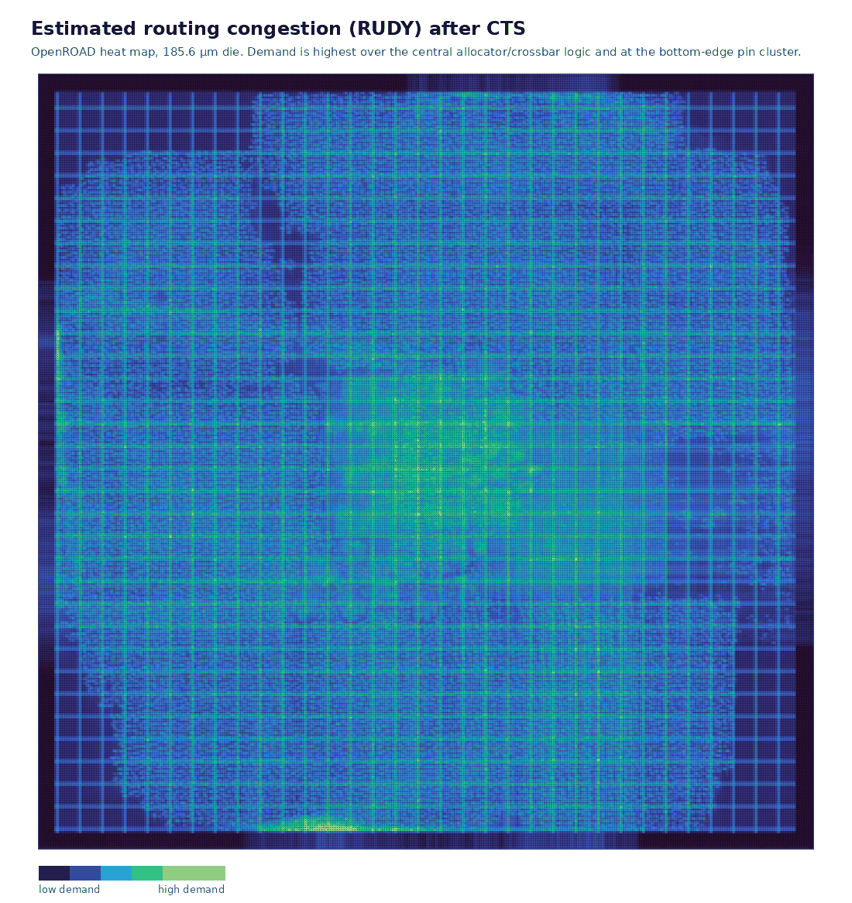
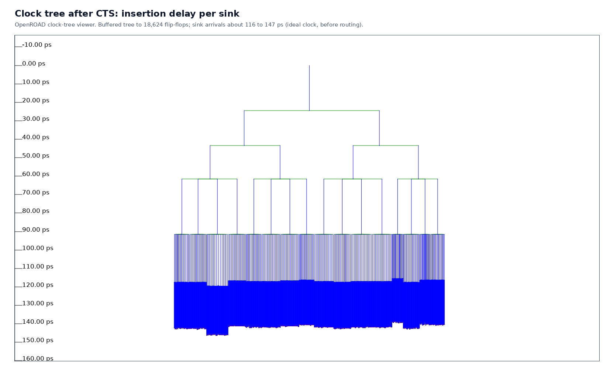

# Micro-NVSwitch: 8x8 NoC Router with In-Network FP8 Reduction (Verilog RTL, ASAP7 7nm Layout)

Micro-NVSwitch is an 8-port network-on-chip router written in Verilog and implemented on the ASAP7 7nm predictive PDK with Yosys, OpenROAD and OpenSTA. The design is loosely modelled on the role an NVSwitch plays in a GPU fabric. It routes unicast and multicast packets between eight ports, and it has a small reduction ALU that can combine the payloads of two packets as they cross the switch, in the spirit of Mellanox/NVIDIA SHARP [2].

The point of putting a reduction unit in a switch is that an All-Reduce then needs fewer trips through the network: partial sums are combined in the fabric instead of at every endpoint. This repository implements a one-switch, two-operand version of that idea. It is a study of the router microarchitecture and of what the open-source ASAP7 flow can do with it, not a model of a production NVSwitch.

| Stage | Status | Result |
|---|---|---|
| RTL | done | 5 modules + 1 package in `rtl/`, Verilator lint clean |
| Simulation | done | 14/14 cocotb tests, 6/6 Icarus testbench checks |
| Synthesis | done | Yosys 0.46 → ASAP7 RVT: 92,890 cells, 14,192 µm² |
| Floorplan, placement, CTS, global route | done | OpenROAD, 185.6 µm × 185.6 µm die, 0 routing overflow |
| Static timing and power | done, estimated parasitics | 2.5 ns clock: setup +74 ps, hold −15 ps (fails), 142 mW |
| Detailed route, GDSII, DRC/LVS | scripted, not run | [Limitations](#limitations) |

## Architecture


*Figure 1. `router_top` block diagram. A single-flit packet takes three cycles from `i_flit_valid` to `o_flit_valid`.*

All parameters come from `rtl/include/router_pkg.v`: 8 ports, 4 virtual channels (VCs) per port, 8-flit buffers and 64-bit flits. A flit carries a 2-bit type (HEAD, BODY, TAIL or SINGLE) alongside its data. The head flit holds an 8-bit destination mask in bits [63:56], so any subset of outputs can be addressed and multicast needs no separate packet format. It also holds the source port, an 8-bit packet ID and a 3-bit SHARP opcode.

**Input buffering (`vc_buffer.v`).** The incoming flit is written to one of four FIFOs selected by `i_flit_vc`. Each entry stores 66 bits (type + data). When a flit leaves, the FIFO pulses its bit of `o_credit_ret`, which tells the upstream sender it may send one more flit on that VC.

**VC allocation (`router_top.v`).** When a HEAD or SINGLE flit reaches the front of a FIFO, the allocator grants it only if every output VC named in its destination mask is free, and then locks all of them in the same cycle. That output VC stays locked until the packet's TAIL leaves, so packets on the same output VC never interleave. The all-or-nothing grant is meant to stop two multicast packets from each holding part of the other's destination set.

**Switch allocation (`islip_arbiter.v`).** Each input offers one VC per cycle, chosen round-robin among VCs that own their output VCs and have at least one destination with a downstream credit. These offers form a 64-bit request matrix. Each output then grants one requesting input using its own round-robin pointer. Despite the file name, this is a single-pass output-side arbiter, not the full iSLIP algorithm [1]: there is no input accept stage, and one input can win several outputs in the same cycle. That is what lets a multicast flit reach all its destinations at once when they are free. Destinations that are not granted are tracked in a per-VC `served` mask and retried, and the flit is dequeued only after all of them have received it.

**Crossbar and credits (`crossbar_8x8.v`).** Grants select the source for each output mux, and `PIPELINED=1` adds an output register. The router keeps a 4-bit credit counter for each output VC. The counter is decremented when a flit is granted and incremented on `i_credit_ret`. A VC with no credit is excluded from the request matrix, so the router never sends a flit the downstream buffer cannot hold.

**Reduction ALU (`sharp_alu.v`).** If input port 0 carries a packet with a non-zero `sharp_op` and input port 1 is switching a flit in the same cycle, the ALU combines the two 64-bit payloads. It supports FP8 E4M3 [3] SUM, MAX and MIN on 8 lanes, INT32 SUM on 2 lanes, and XOR. The result appears on `o_sharp_result` and `o_sharp_active` one cycle later. It is not written back into a packet, and the fixed operand ports and the simplified FP8 adder are listed under [Limitations](#limitations).

**Telemetry and power intent.** `o_occupancy` and `o_vc_idle` export the fill level of each FIFO. `constraints/power.upf` (UPF) and `power.cpf` (CPF) describe one switchable power domain per input port. They are not used by the OpenROAD flow and have not been checked with power-aware simulation.

## Design Flow


*Figure 2. Flow used in this repository. Dashed steps have scripts but no results yet.*

```bash
make lint      # Verilator --lint-only -Wall
make sim       # Icarus Verilog testbench, dv/common/tb_router_top.v
make cocotb    # cocotb suite, dv/cocotb/tests/
```

The ASAP7 flow runs inside the `ghcr.io/efabless/openlane2:2.3.10` container. It needs Docker and the ASAP7 platform directory from OpenROAD-flow-scripts, which `flow/run_flow.sh` expects at `~/pdks/orfs/flow/platforms/asap7` (override with `PLATFORM_HOST`):

```bash
git clone --depth 1 --filter=blob:none --sparse \
    https://github.com/The-OpenROAD-Project/OpenROAD-flow-scripts.git ~/pdks/orfs
git -C ~/pdks/orfs sparse-checkout set flow/platforms/asap7

flow/run_flow.sh synth floorplan place cts groute sta-groute   # results below
flow/run_flow.sh route finish sta                              # detailed route onwards, not yet run to completion
```

Every stage writes a checkpoint to `build/odb/`, so a stage can be rerun without repeating the earlier ones. Scripts for Cadence Genus, Synopsys DC and Cadence Innovus are in `synth/` and `pnr/innovus/`. They have not been run.

## Verification

The cocotb suite is the main regression. `test_router.py` covers reset and credit initialisation, unicast, multi-flit wormhole packets, multicast, head-of-line blocking across VCs, lossless backpressure and FP8 summation. `test_router_fixes.py` holds the regression tests for bugs fixed in the RTL: body flits staying with their own header, no interleaving on an output VC, partially granted multicast, multicast to a destination with zero credit, credit-counter overrun, the ALU firing only when both operands are present, and random traffic checked against a scoreboard. All 14 tests pass.

The Icarus testbench (`make sim`) is a quick smoke test. Its six checks pass, but the SHARP check (TEST 5) counts as a pass even when the ALU never fires. The cocotb SHARP tests check that the ALU fires only when both operands are present, but no test yet compares `o_sharp_result` against expected FP8, INT32 or XOR values.


*Figure 3. TEST 2 (port 0 → port 4) and TEST 3 (port 2 → ports 1, 3, 5, 7) from the testbench VCD. Both take three cycles, and the four multicast copies leave in the same cycle.*

The test plan is in [`docs/verification_plan.md`](docs/verification_plan.md).

## Synthesis

`synth/yosys/scripts/synth_asap7.tcl` maps the design to the ASAP7 RVT typical-corner libraries with Yosys 0.46. `check` reports no problems.

| Cell group | Count |
|---|---:|
| Flip-flops (`DFFASRHQNx1`) | 18,624 |
| AO / OA / AOI / OAI complex gates | 34,108 |
| AND / OR / NAND / NOR (+1 tie cell) | 26,462 |
| Buffers and inverters | 12,768 |
| XOR / XNOR / MAJ | 928 |
| **Total** | **92,890** |

Cell area is 14,192 µm², and 49.8% of it is sequential. The VC FIFOs are synthesised as flip-flops: 8 ports × 4 VCs × 8 entries × 66 bits is 16,896 of the 18,624 flip-flops, so buffer storage takes about half the cell area. The ORFS ASAP7 platform does include fakeram macros, which could replace these registers in a later revision. Full reports: [`synth_asap7_stat.rpt`](synth/yosys/reports/synth_asap7_stat.rpt), [`synth_asap7_check.rpt`](synth/yosys/reports/synth_asap7_check.rpt).

## Physical Design

Results are for ASAP7 RVT at the typical corner (0.70 V) with a 2.5 ns clock. Timing uses parasitics estimated from global routes, not extracted from wires, so the numbers will move once detailed routing runs.

| Metric | Value | Source |
|---|---|---|
| Setup WNS / TNS | +74 ps / 0 ps (≈412 MHz) | `signoff/sta/reports/summary.rpt` |
| Hold WNS / TNS | −15 ps / −3,057 ps | `signoff/sta/reports/summary.rpt` |
| Cell area / utilization | 16,531 µm² / 52.5% | `pnr/openroad/reports/4_groute_summary.rpt` |
| Standard cells (excl. tap) | 115,201, of which 6,451 hold buffers | post-CTS database (`build/odb/3_cts.odb`, regenerated by the flow, not committed) |
| Clock tree | 2,350 buffers, 18,624 sinks, 82.8 ps setup skew | `pnr/openroad/reports/cts.rpt`, `signoff/sta/reports/clock_skew.rpt` |
| Global routing | 114,115 nets, 813,577 µm, 21.95% usage, 0 overflow | `groute` stage log (`build/logs/5_groute.log`, not committed) |
| Total power | 142 mW (80% combinational, 14% sequential, 6% clock) | `signoff/sta/reports/power.rpt` |

| Stage | Setup WNS | Hold WNS | Utilization |
|---|---|---|---|
| Placement | +146 ps | +39 ps | 49.3% |
| CTS + hold repair | +125 ps | +4.7 ps | 52.8% |
| Global route | +51 ps | −15 ps | 52.5% |

The worst setup path starts at a flip-flop, goes through the input VC selection logic into `req_matrix`, then through the switch allocator (`granted_out_mask`) and the crossbar input mux to a flip-flop. VC selection, switch allocation and crossbar selection all happen in one cycle. That is why the original 800 ps target failed by 1.6 ns.


*Figure 4. Placement after CTS, coloured by cell type (synthesis flattened the hierarchy, so cells cannot be coloured by module). Flip-flops cover most of the die, and combinational logic is concentrated in the centre. Hold buffers sit along the die edges near the I/O pins, which fits with the worst hold paths starting at input ports.*



*Figure 5. Estimated routing demand (RUDY [5]) after CTS. Demand is highest over the central logic and at the bottom-edge pins. Global routing finished with no overflow.*



*Figure 6. Clock tree after CTS, plotted by insertion delay.*

### Limitations

- **Clock target.** At 800 ps (`constraints/router.sdc`) the post-placement setup WNS was −1,604 ps, so the open flow uses 2.5 ns (`constraints/router_openroad.sdc`). Reaching the original target would need a register between switch allocation and the crossbar, which adds a cycle of latency.
- **No detailed routing or GDSII.** TritonRoute ran out of memory on a 3.7 GB WSL host. The `route` and `finish` stages are scripted and start from the CTS checkpoint.
- **Hold.** All ten paths in `signoff/sta/reports/hold.rpt` (the worst violators) start at input ports. The SDC sets a 50 ps minimum input delay against a clock insertion delay of roughly 240–280 ps. The input-delay constraint needs to be confirmed against the real environment, or hold must be repaired after routing.
- **SPEF delimiter.** OpenROAD writes `*DELIMITER :` but names pins `inst/pin`, and OpenSTA then drops the parasitics without an error. `flow/fix_spef_delimiter.py` rewrites the file in the `groute` stage.
- **Reduction ALU scope.** Operands are fixed to input ports 0 and 1, and the result is only visible on telemetry ports. The whole 64-bit flit is reduced, so on a SINGLE flit the header bits are reduced too. The FP8 adder truncates instead of rounding and does not renormalise after cancellation. Its overflow value, `0x7F`/`0xFF`, is NaN in E4M3, not the largest finite value.
- **Power intent.** Each port's UPF power switch is controlled only by `o_vc_idle` of VC0, so it could gate a port while VCs 1 to 3 still hold flits. The control expression `o_vc_idle[p*4]` is also inside braces, so Tcl will not substitute `p`. The UPF has not been run through any tool.

## Repository Layout

```
rtl/            router_pkg.v, vc_buffer.v, islip_arbiter.v, crossbar_8x8.v, sharp_alu.v, router_top.v
dv/             common/tb_router_top.v (Icarus), cocotb/ (cocotb suite)
constraints/    router.sdc (800 ps), router_openroad.sdc (2.5 ns), power.upf, power.cpf
synth/          Yosys scripts and reports; Genus and DC scripts
pnr/            OpenROAD stage scripts and reports; Innovus script
signoff/sta/    OpenSTA script and reports
flow/           run_flow.sh, asap7_env.sh, fix_spef_delimiter.py
docs/           microarchitecture.md, verification_plan.md, physical_design_guide.md, images/
```

## Releases

| Version | Date | Contents |
|---|---|---|
| [v0.1.0](https://github.com/Srijit6/micro-nvswitch-noc-router/releases/tag/v0.1.0) | 2026-11-08 | RTL passing 14/14 cocotb tests, ASAP7 synthesis, OpenROAD through global routing, OpenSTA at 2.5 ns |

Planned for v1.0.0: detailed routing, GDSII with DRC/LVS, hold closure, and a pipelined switch allocator.

## References and Tools

1. N. McKeown, "The iSLIP scheduling algorithm for input-queued switches," *IEEE/ACM Trans. Networking*, vol. 7, no. 2, pp. 188–201, 1999.
2. R. L. Graham et al., "Scalable Hierarchical Aggregation Protocol (SHArP): A Hardware Architecture for Efficient Data Reduction," *Proc. COMHPC Workshop*, 2016. SHARP and NVSwitch are trademarks of NVIDIA. This project is not affiliated with NVIDIA.
3. P. Micikevicius et al., "FP8 Formats for Deep Learning," arXiv:2209.05433, 2022.
4. L. T. Clark et al., "ASAP7: A 7-nm finFET predictive process design kit," *Microelectronics Journal*, vol. 53, pp. 105–115, 2016. The ASAP7 platform files are downloaded from OpenROAD-flow-scripts and are not redistributed here.
5. P. Spindler and F. M. Johannes, "Fast and accurate routing demand estimation for efficient routability-driven placement," *Proc. DATE*, 2007.
6. W. J. Dally and B. Towles, *Principles and Practices of Interconnection Networks*, Morgan Kaufmann, 2004. Background for virtual channels, credit-based flow control and wormhole switching.

Tools: [Yosys](https://github.com/YosysHQ/yosys), [OpenROAD](https://github.com/The-OpenROAD-Project/OpenROAD), [OpenSTA](https://github.com/parallaxsw/OpenSTA), [Verilator](https://github.com/verilator/verilator), [Icarus Verilog](https://github.com/steveicarus/iverilog), [cocotb](https://github.com/cocotb/cocotb), and the [OpenLane 2](https://github.com/efabless/openlane2) container. All figures were generated from this repository's own simulation and layout data.

## License

MIT, see [`LICENSE`](LICENSE). The license covers this repository's own files only. ASAP7 platform files and the tools listed above keep their own licenses.
